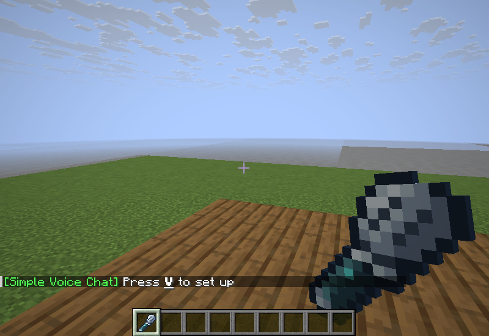

# Microphone! (Simple Voice Chat)

Craft a handheld microphone, pick how far your voice should carry, and speak using your usual Simple Voice Chat controls. Bring a 64-block mic to a market stall or switch to 256 blocks for a crowd. Players can use a crafted mic without operator access.

**[Download Microphone! 0.2.0 for Fabric 26.3](https://github.com/Sqeedys/Microphone-SVC/raw/refs/heads/main/downloads/microphone-0.2.0.jar)** · [Checksums](downloads/SHA256SUMS.txt)

## Install

1. Set up **Minecraft Java 26.3**, **Java 25** and **Fabric Loader 0.20.1** on the server and on each player's client.
2. On **both** sides, put the Microphone! JAR, Fabric API **0.165.2+26.3**, and Simple Voice Chat **2.6.27+26.3** in the `mods` folder. The microphone is a registered item with its own texture. [Fabric API](https://maven.fabricmc.net/net/fabricmc/fabric-api/fabric-api/0.165.2%2B26.3/) · [Exact Simple Voice Chat build](https://modrinth.com/plugin/simple-voice-chat/version/x9jLR94Q)
3. Restart and check that you can hear a nearby player through Simple Voice Chat. A new voice server needs its UDP port configured. [Voice server setup](https://modrepo.de/minecraft/voicechat/wiki/server_setup)

## Craft and use

Use one copper ingot, three iron ingots and one redstone dust in a crafting table.

| Left | Middle | Right |
|:---:|:---:|:---:|
| | Copper ingot | |
| Iron ingot | Redstone dust | Iron ingot |
| | Iron ingot | |

**Right-click** with the mic in either hand to switch it on or off. **Sneak + right-click** to cycle **64 → 128 → 192 → 256 blocks**. The action bar shows your selection. Speak normally or use your usual push-to-talk key. Putting the mic away switches it off, and the item remembers its range.

These settings change how far other players can hear you. Sound fades over distance, and listeners keep their personal volume controls. Whisper and group conversations use Simple Voice Chat's normal routing. Ordinary voice defaults to 48 blocks upstream. [Simple Voice Chat settings](https://modrepo.de/minecraft/voicechat/wiki/server_config)



## Server owners

After the first start, edit `config/microphone.json` on the server and restart. The four ranges must be increasing whole numbers from 1 through 1024.

- Set `craftingEnabled` to `false` to remove the recipe while keeping existing handheld mics usable.
- Set `handheldEnabled` to `false` for a staff-only setup. This turns off ordinary handheld amplification, including for items already crafted, and removes the recipe. Staff can still issue an event mic.

```json
{
  "handheldEnabled": true,
  "craftingEnabled": true,
  "ranges": [64, 128, 192, 256]
}
```

For a staffed event, `/eventvoice start` opens a session. The host can give a presenter a mic, choose a local range or go global, mute the audience, and make individual exceptions. [Staff commands and permissions](docs/staff.md) · [Build and verification](docs/development.md)

Created by **Sqeedys**. [More mods](https://sqeedys.com/mods) · [YouTube @Sqeedys](https://www.youtube.com/@Sqeedys) · [MIT license](LICENSE)
